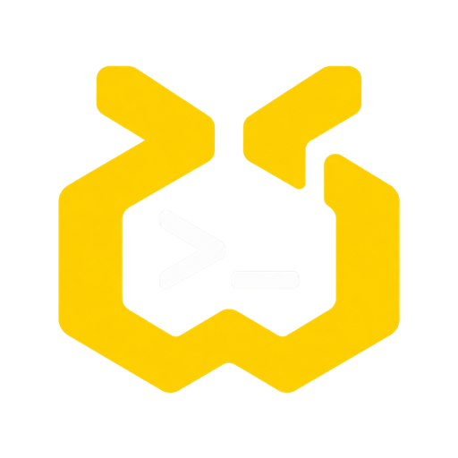
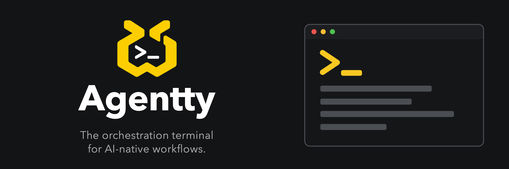

<h1 align="center">
  <a href="https://www.agentty.run"></a> Agentty
</h1>

<p align="center">
  <a href="https://github.com/empty-user77/Agentty"></a>
  <a href="https://github.com/empty-user77/Agentty/releases"></a>
  <a href="LICENSE"></a>
  <a href="https://x.com/agentty_run"></a>
  
</p>

<p align="center">
  <sub><a href="README.md">English</a> · <b>한국어</b> · <a href="README.ja.md">日本語</a> · <a href="README.zh.md">中文</a></sub>
</p>

<p align="center">
  <strong>AI-네이티브 워크플로우를 위한 오케스트레이션 터미널입니다.</strong><br/>
  Claude Code, Codex 등 여러 에이전트를 나란히 띄우고 누가 일하는지, 끝났는지, 나를 기다리는지 한눈에 봅니다.
</p>

<p align="center">
  <b>나아가는 방향:</b> 플러그인으로 환경과 상황에 맞는 에이전트를 만들고, 그 모든 에이전트를 Agentty 하나에서 실행합니다.<br/>
  FDE(Forward Deployed Engineer, 전방 배치 엔지니어)처럼, 일관된 한 곳에서 여러 종류의 에이전트를 만듭니다.
</p>

<h3 align="center"><a href="https://github.com/empty-user77/Agentty/releases/latest"><ins>Agentty 다운로드</ins></a> · <a href="https://www.agentty.run/docs"><ins>문서</ins></a></h3>

<p align="center">
  
</p>

Rust로 만든 네이티브 GPU 렌더링 터미널입니다. [GPUI](https://gpui.rs)와 `alacritty_terminal`을 사용하며 Electron은 없습니다.
에이전트마다 작업에 필요한 프로젝트 파일, Git 이력, 컨테이너, 데이터베이스를 함께 줍니다.

## 나아가는 방향: FDE 관점의 에이전트 플랫폼

**FDE**(Forward Deployed Engineer, 전방 배치 엔지니어)는 고객 현장에 들어가 그곳에 필요한 도구, 데이터,
규칙을 직접 만드는 엔지니어입니다. 범용 제품 하나를 건네지 않고 현장에 맞춘 것을 만듭니다. Agentty는 AI 에이전트를
이 방향으로 키워 가고 있습니다.

모든 팀, 모든 기술 스택, 모든 상황에 맞는 에이전트 하나는 없습니다. 그래서 Agentty는 역할을 둘로 나눕니다.

| | |
|---|---|
| **플러그인 — 환경과 상황에 맞는 에이전트를 만든다** | 업무별 스킬과 규칙([AgentOS](https://www.agentty.run/docs/plugin-agentos)), 다루는 도구와 사이트, 따르는 단계와 완료 기준, 허용하는 권한을 팀·고객·상황 단위로 한 번에 묶습니다. |
| **Agentty — 모든 에이전트를 하나의 일관된 환경에서 실행한다** | 어떤 플러그인이 어떤 에이전트를 움직이든, 같은 터미널, 세션, git 워크트리, 인앱 브라우저, 데이터베이스, 컨테이너, 자격 증명 저장소, 사용량, 알림 위에서 돌아갑니다. |

그래서 얻는 것:

- **환경마다 만들고, 모든 에이전트를 같은 방식으로 실행합니다.** 한 고객의 기술 스택에 맞춘 에이전트와 마케팅 주간을 돌리는
  에이전트가 같은 창에서, 같은 방식으로 나란히 돌아갑니다.
- **모든 에이전트가 보이고, 손에서 벗어나지 않습니다.** 각 단계는 읽고, 멈추고, 이어받을 수 있는 실제 에이전트 세션이고
  플러그인은 무엇을 할 수 있는지 설치 전에 밝힙니다.
- **현장에서 만든 것이 그대로 쓰입니다.** 플러그인으로 묶어 [마켓플레이스](https://github.com/empty-user77/Agentty-Marketplace)나 Git 저장소로 배포하면
  어느 Agentty에서든 실행됩니다.

지금도 플러그인은 패널과 자동화 작업공간을 더하고 선언한 사이트에서 인앱 브라우저를 다룹니다. AgentOS 플러그인은 에이전트
세션으로 일을 진행합니다. 플러그인 API는 이 방향으로 계속 넓어집니다. [플러그인 →](https://www.agentty.run/docs/plugins-overview)

## 기능

<table>
<tr>
<td width="50%" valign="top">

### 모든 에이전트를 한 창에서

터미널, Claude Code, Codex와 다른 CLI 에이전트를 워크스페이스, 탭, 분할창으로 정리합니다. 다시 시작해도 모두 그대로 돌아옵니다.

[문서 →](https://www.agentty.run/docs/workspaces-tabs-panes)

</td>
<td width="50%" valign="top">

### 나를 기다리는 에이전트를 한눈에

각 페인과 워크스페이스에서 에이전트가 작업 중인지, 완료했는지, 응답을 기다리는지 표시됩니다. 데스크톱, 메뉴 막대는 물론 Slack, Discord, Telegram으로도 알림을 받습니다.

[문서 →](https://www.agentty.run/docs/agent-status)

</td>
</tr>
<tr>
<td width="50%" valign="top">

### 세션 연결

한 에이전트에서 다른 에이전트로 선을 이어 컨텍스트를 넘깁니다. 양방향으로 계속 동기화하거나 Claude Code와 Codex 사이에서 대화를 옮길 수도 있습니다.

[문서 →](https://www.agentty.run/docs/session-flow)

</td>
<td width="50%" valign="top">

### 병렬 워크트리

같은 프로젝트에 두 번째 에이전트를 띄우면 새 브랜치의 별도 git 워크트리에서 시작할지, 쓰던 워크트리에 합류할지 고릅니다. 에이전트가 작업을 여러 세션으로 나누자고 하면 확인 후 한 번에 시작됩니다.

[문서 →](https://www.agentty.run/docs/agent-git)

</td>
</tr>
<tr>
<td width="50%" valign="top">

### AgentGit

저장소·브랜치 전환, diff 검토, 파일 골라 커밋하기, 이력 탐색, fetch, pull, push, merge까지 에이전트가 돌아가는 창을 떠나지 않고 처리합니다.

[문서 →](https://www.agentty.run/docs/agent-git)

</td>
<td width="50%" valign="top">

### 인앱 브라우저

개발 서버를 터미널 옆에 열고 휴대폰·태블릿 크기로도 봅니다. 에이전트가 페이지를 직접 조작해 만든 것을 테스트할 수도 있습니다.

[문서 →](https://www.agentty.run/docs/in-app-browser)

</td>
</tr>
<tr>
<td width="50%" valign="top">

### 데이터베이스 & Docker

프로젝트에 이미 설정된 데이터베이스를 둘러봅니다. 에이전트는 읽기 전용 트랜잭션 안에서 조회합니다. 쓰기는 실행할 SQL을 그대로 보여 주는 승인 창에서 승인해야 실행됩니다. 컨테이너, 포트, 로그도 바로 옆에 보입니다.

[문서 →](https://www.agentty.run/docs/databases)

</td>
<td width="50%" valign="top">

### 플러그인 & 자동화

플러그인은 패널, 버튼, 팔레트 명령을 더하고 다른 앱을 끌어옵니다. 자동화 에이전트는 플러그인 전용 워크스페이스에서 돌아갑니다. [Marketplace](https://github.com/empty-user77/Agentty-Marketplace)에서 찾거나 직접 만들 수 있습니다.

[문서 →](https://www.agentty.run/docs/plugins-overview)

</td>
</tr>
</table>

**추가 기능:**

- **[세션](https://www.agentty.run/docs/sessions)** — 컴퓨터에 이미 있는 Claude Code·Codex 세션을 둘러보고 검색해서 이어 갑니다.
- **[모니터링](https://www.agentty.run/docs/monitoring)** — 로컬 대화 기록으로 계산한 비용·토큰·캐시 적중률, 실행 중인 AI 프로세스, 컴퓨터의 모든 git 워크트리, 빌드 결과물과 캐시를 정리하는 디스크 페이지.
- **[확장, MCP와 커넥터](https://www.agentty.run/docs/mcp-and-connectors)** — Claude Code와 Codex의 스킬, 서브에이전트, 명령, MCP 서버를 한곳에서 보고, 비밀값은 OS가 보관합니다.
- **[Build my idea](https://www.agentty.run/docs/build-my-idea)** 와 **[Launch](https://www.agentty.run/docs/launch)** — 몇 줄 설명을 에이전트가 만들 수 있는 프로젝트로 바꾸고 GitHub, Vercel, Supabase로 공개합니다.
- **[Claude advisor](https://www.agentty.run/docs/advisor)** — 중요한 순간에 Claude Code가 더 강한 모델에게 조언을 구하게 합니다. 탭마다 설정합니다.
- **파일 & 편집기** — 프로젝트 트리와 구문 강조, 포매터가 있는 편집기, VS Code나 Cursor에서 열기.
- **명령 팔레트, 안 읽은 알림으로 이동, 미니 모드** — ⇧⌘P, ⇧⌘U, ⌃⌘M; [단축키](#단축키)를 참고하세요.

---

## 지원하는 에이전트

**모든 CLI 에이전트**에서 작동합니다 — 터미널에서 실행되면 Agentty에서도 실행됩니다. 아래 에이전트는 Agentty가 자동으로 찾아 실행 메뉴에 보여 줍니다:

<p>
  <a href="https://docs.anthropic.com/en/docs/claude-code"><kbd> Claude Code</kbd></a> &nbsp;
  <a href="https://github.com/openai/codex"><kbd> Codex</kbd></a> &nbsp;
  <a href="https://github.com/google-gemini/gemini-cli"><kbd> Gemini CLI</kbd></a> &nbsp;
  <a href="https://antigravity.google"><kbd> Antigravity CLI</kbd></a> &nbsp;
  <a href="https://ampcode.com"><kbd> Amp</kbd></a> &nbsp;
  <a href="https://docs.github.com/en/copilot/how-tos/set-up/install-copilot-cli"><kbd> GitHub Copilot CLI</kbd></a> &nbsp;
  <a href="https://cursor.com/cli"><kbd> Cursor CLI</kbd></a> &nbsp;
  <a href="https://opencode.ai"><kbd> OpenCode</kbd></a> &nbsp;
  <a href="https://github.com/QwenLM/qwen-code"><kbd> Qwen Code</kbd></a> &nbsp;
  <a href="https://docs.factory.ai/cli/getting-started/quickstart"><kbd> Factory Droid</kbd></a> &nbsp;
  <a href="https://block.github.io/goose/"><kbd> Goose</kbd></a> &nbsp;
  <a href="https://github.com/charmbracelet/crush"><kbd> Crush</kbd></a> &nbsp;
  <a href="https://aider.chat"><kbd> Aider</kbd></a> &nbsp;
  <a href="https://github.com/MoonshotAI/kimi-cli"><kbd> Kimi CLI</kbd></a> &nbsp;
  <a href="https://kiro.dev/docs/cli/"><kbd> Kiro CLI</kbd></a> &nbsp;
  <a href="https://docs.cline.bot/cline-cli/overview"><kbd> Cline CLI</kbd></a> &nbsp;
  <a href="https://x.ai/cli"><kbd> Grok Build</kbd></a> &nbsp;
  <a href="https://ollama.com"><kbd> Ollama (local models)</kbd></a> &nbsp;
  <kbd>+ 모든 CLI 에이전트</kbd>
</p>

Claude Code와 Codex는 더 깊이 연동됩니다. 훅으로 받는 실시간 상태, 세션, 사용량과 비용, 두 에이전트 사이의 핸드오프까지.

---

## 설치

### macOS — Apple silicon, macOS 13+

```sh
brew install --cask empty-user77/agentty/agentty
```

끝입니다. Agentty가 응용 프로그램 폴더에 설치됩니다. Homebrew가 없다면 먼저 [brew.sh](https://brew.sh)의 한 줄 명령으로 설치하세요. Agentty는 알아서 업데이트됩니다. `brew upgrade --cask agentty`로 올려도 되고
`brew uninstall --cask agentty`로 지웁니다.

직접 내려받으려면 [최신 릴리스](https://github.com/empty-user77/Agentty/releases/latest)에서 `Agentty-X.Y.Z-…-arm64.dmg`를 받아 열고 **Agentty**를 **응용 프로그램**으로 드래그하세요. Apple 서명과 공증을 거친 빌드입니다. Intel Mac용 빌드는 없습니다.

### Windows — 10 version 1809+, x64

1. [최신 릴리스](https://github.com/empty-user77/Agentty/releases/latest)에서 `Agentty-X.Y.Z-windows-x64-setup.exe`를 내려받습니다. 브라우저가 `.exe`를 막으면
   `Agentty-X.Y.Z-windows-x64-setup.zip`을 받아 압축을 푸세요. 같은 설치 파일이 들어 있습니다.
2. 실행하세요. 현재 사용자에게만 설치되고 관리자 권한은 필요 없습니다.
3. 설치 파일은 아직 코드 서명이 안 되어 있습니다. SmartScreen이 뜨면 **추가 정보 → 실행**을 누르세요.

삭제: 설정 → 앱 → Agentty → 제거.

### Linux — x86_64

[최신 릴리스](https://github.com/empty-user77/Agentty/releases/latest)에서 배포판에 맞는 패키지를 내려받은 뒤:

```sh
# Debian 12+ / Ubuntu 22.04+
sudo apt install ./Agentty-*-linux-amd64.deb

# RHEL 9+ / Fedora
sudo dnf install ./Agentty-*-linux-x86_64.rpm
```

삭제: `sudo apt remove agentty` 또는 `sudo dnf remove agentty`.

### 업데이트

Agentty는 실행할 때와 매시간 새 버전을 확인합니다. macOS와 Windows에서는 업데이트를 내려받아 릴리스 체크섬으로 검증한 뒤 설치하고 다시 시작합니다. Linux에서는 새 버전을 알리고 패키지 페이지로 안내합니다.

### 시작하기 전에

Agentty는 에이전트를 실행만 하고 따로 담고 있지는 않습니다. 사용할 CLI를 설치하고 `PATH`에 있는지 확인하세요. 예: [Claude Code](https://docs.anthropic.com/en/docs/claude-code)(`claude`), [Codex](https://github.com/openai/codex)(`codex`). Agentty의 설정 → 시스템에서 빠진 것을 설치할 수도 있습니다.

### 소스에서 빌드

```sh
git clone https://github.com/empty-user77/Agentty.git
cd Agentty
cargo run --release -p agentty-app
```

Rust 1.98(`rust-toolchain.toml`에 고정)과 플랫폼별 빌드 도구가 필요합니다. Windows와 Linux는
[docs/platforms.md](docs/platforms.md)를 참고하세요.

---

## 단축키

| 동작 | 단축키 |
|---|---|
| 새 터미널 / Claude Code / Codex 탭 | ⌘T / ⌥⌘C / ⌥⌘X |
| 오른쪽 / 아래로 분할 | ⌘D / ⇧⌘D |
| 다음 / 이전 페인 · 탭 · 워크스페이스 | ⌘] ⌘[ · ⇧⌘] ⇧⌘[ · ⌥⌘↓ ⌥⌘↑ |
| 명령 팔레트 · 안 읽은 알림으로 이동 | ⇧⌘P · ⇧⌘U |
| Git · 세션 연결 · 모니터링 · 설정 | ⇧⌘G · ⇧⌘F · ⌥⌘U · ⌘, |
| 파일 패널 · 인앱 브라우저 · 미니 모드 | ⌥⌘B · ⇧⌘B · ⌃⌘M |

전체 목록은 **설정 → 단축키**에 있습니다. Windows와 Linux에서는 ⌘ → Ctrl+Shift, ⇧⌘ → Ctrl+Alt+Shift,
⌥⌘ → Ctrl+Alt로 바뀝니다. 그래서 Ctrl+문자 조합은 셸이 그대로 받습니다.

## 플러그인

플러그인은 터미널 옆 패널을 채우고 에이전트 페인 위에 버튼을, 명령 팔레트에 항목을 더합니다. 프롬프트도 보낼 수 있는데, 보낼 곳은 언제나 "보낼 위치 선택" 창에서 사용자가 고릅니다. 플러그인이 요청하는 권한은 설치 전에 플러그인 페이지에서 볼 수 있고, 이 권한이 플러그인이 Agentty에 요청할 수 있는 일의 범위입니다. WebAssembly 플러그인은 그 밖의 어떤 것에도 접근하지 못합니다. Node.js, Python, 네이티브 프로그램으로 도는 플러그인은 Agentty 밖에서 사용자와 똑같이 파일과 네트워크에 접근하니 믿을 수 있는 것만 설치하세요. 플러그인은
[Agentty Marketplace](https://github.com/empty-user77/Agentty-Marketplace)에서 배포됩니다.

플러그인은 Agentty가 FDE 방향으로 나아가는 바탕입니다(위의 "나아가는 방향" 참고). 플러그인으로 팀·고객·상황마다 맞는
에이전트를 만들고, Agentty 하나에서 그 에이전트를 모두 일관되게 실행합니다.

기본 제공되는 **Cosmica** 플러그인은 [Cosmica](https://www.cosmica.ink/) 노트를 프롬프트로 바꾸고 세션 요약을 다시 저장합니다. 직접 만들려면 [docs/plugins](docs/plugins/README.md)를 참고하세요. 플러그인 페이지에서 새 플러그인을 만들어 Claude Code에게 구현을 맡겨도 됩니다.

## 문서

| | |
|---|---|
| [agentty.run/docs](https://www.agentty.run/docs) | 앱의 각 부분이 하는 일 |
| [docs/ko](docs/ko/introduction.md) | 마크다운 형식의 사용자 문서 ([English](docs/en/introduction.md) · [日本語](docs/ja/introduction.md) · [中文](docs/zh/introduction.md)) |
| [docs/configuration.md](docs/configuration.md) | `settings.json`, 에이전트 로그인, 하네스, 데이터베이스, 테마, Agentty가 만드는 파일 |
| [docs/platforms.md](docs/platforms.md) | Windows와 Linux에서 다른 점과 빌드 방법 |
| [docs/plugins](docs/plugins/README.md) | 플러그인 만들기 (Node.js SDK 또는 [프로토콜](docs/plugins/protocol.md))와 [사용법](docs/plugins/usage.md) |
| [docs/architecture.md](docs/architecture.md) | 크레이트, 터미널, 에이전트 소켓, 패널이 어떻게 맞물리는지 |
| [docs/metrics.md](docs/metrics.md) | 공식 빌드가 보낼 수 있는 모든 이벤트와 끄는 방법 |
| [docs/release.md](docs/release.md) | 패키징, 서명, 공증, 릴리스 채널 |

---

## 커뮤니티 & 지원

- **X:** [@agentty_run](https://x.com/agentty_run)을 팔로우하면 업데이트와 공지를 받아 볼 수 있습니다.
- **피드백 & 아이디어:** 뭔가 부족하거나 버그를 찾으셨나요? [이슈를 열어주세요](https://github.com/empty-user77/Agentty/issues).
- **보안:** 취약점은 [SECURITY.md](SECURITY.md)에 설명된 대로 비공개로 보고해주세요.
- **기여:** [CONTRIBUTING.md](CONTRIBUTING.md)와 [행동 강령](CODE_OF_CONDUCT.md)을 먼저 읽어주세요.
- **개인정보:** 에이전트 대화 기록은 세션 목록과 사용량, 핸드오프를 만들 때 **로컬에서만** 읽습니다. 프롬프트, 출력, 경로, 저장소 데이터는 전송하지 않습니다. 공식 릴리스 빌드는 익명 사용 통계(어떤 기능을 썼는지, 앱과 시스템 버전, 무작위 설치 ID)를 보냅니다. 설정 → 일반에서 끌 수 있으며 `DO_NOT_TRACK=1`로도 꺼집니다. 소스 빌드는 아무것도 보내지 않습니다. 보내는 이벤트는 모두 [docs/metrics.md](docs/metrics.md)에 적혀 있습니다.
- **응원:** 이 저장소에 [별](https://github.com/empty-user77/Agentty)을 눌러주세요.

## 라이선스

```
Copyright 2026 LEE YONGBEOM

Licensed under the Apache License, Version 2.0 (the "License");
you may not use this file except in compliance with the License.
You may obtain a copy of the License at

   http://www.apache.org/licenses/LICENSE-2.0

Unless required by applicable law or agreed to in writing, software
distributed under the License is distributed on an "AS IS" BASIS,
WITHOUT WARRANTIES OR CONDITIONS OF ANY KIND, either express or implied.
See the License for the specific language governing permissions and
limitations under the License.
```

전문은 [LICENSE](LICENSE)에 있습니다. 내장 글꼴과 서드파티 구성요소는 각자의 라이선스를 따릅니다 — [THIRD_PARTY_NOTICES.md](THIRD_PARTY_NOTICES.md)를 참고하세요.
